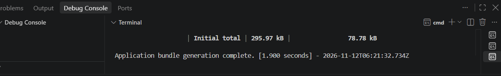
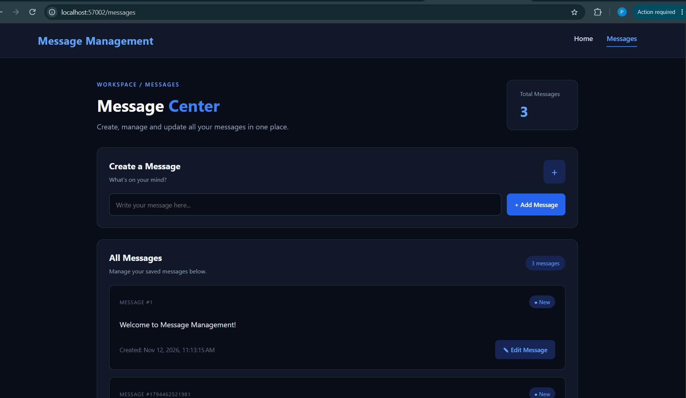
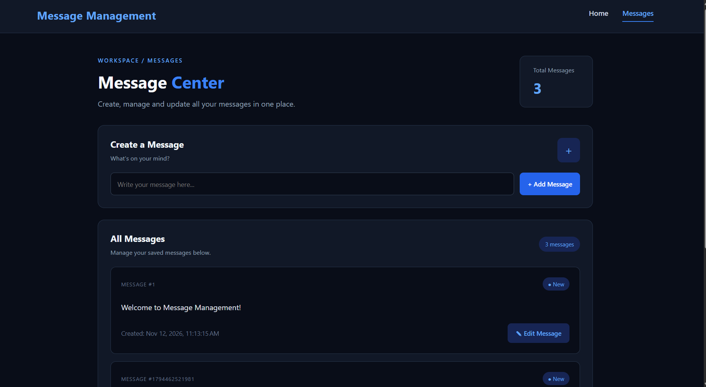
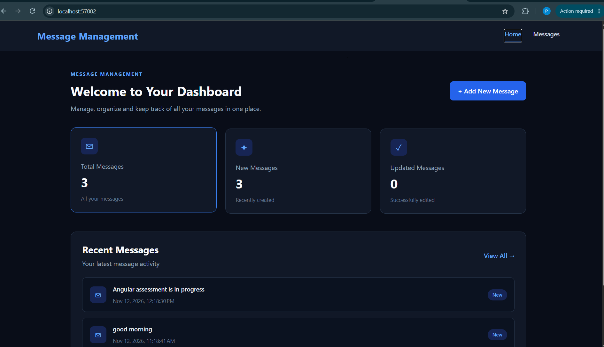
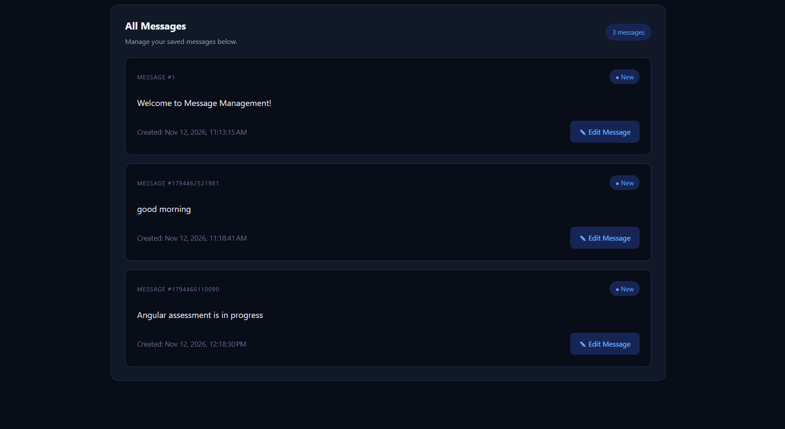

# Message Management Application

## Project Overview

A simple Message Management application built using Angular. It allows users to add and edit messages through an interactive interface.

## Technologies Used

- Angular
- TypeScript
- HTML
- CSS
- Angular Router
- FormsModule

## Features

- Standalone Angular components
- Home and Messages pages with routing
- Navigation between pages
- Injectable MessageService used within the Messages component through dependency injection
- Message model using a TypeScript interface
- Add and edit messages
- Modern Angular control flow using `@if`, `@for`, `@switch`, and `@empty`

## Project Structure

```text
src/
└── app/
    ├── components/
    │   ├── home/
    │   └── messages/
    ├── models/
    │   └── message.model.ts
    ├── services/
    │   └── message.service.ts
    ├── app.routes.ts
    ├── app.config.ts
    └── app.ts
screenshots/
```

## Installation and Setup

1. Clone the repository:

```bash
git clone https://github.com/Parvathyrprasad/angular-assessment.git
```

2. Navigate to the project folder:

```bash
cd angular-assessment
```

3. Install dependencies:

```bash
npm install
```

4. Run the application:

```bash
ng serve -o
```

5. Open the application at:

`http://localhost:4200/`

## Build

To build the application, run:

```bash
ng build
```

The application builds successfully without errors.

## Screenshots

### 1. Successful Angular Build



### 2. Control Flow in Action



### 3. Navigation to the Second Route



### Additional Screenshots

### Home Page



### Navigation to Home Page


